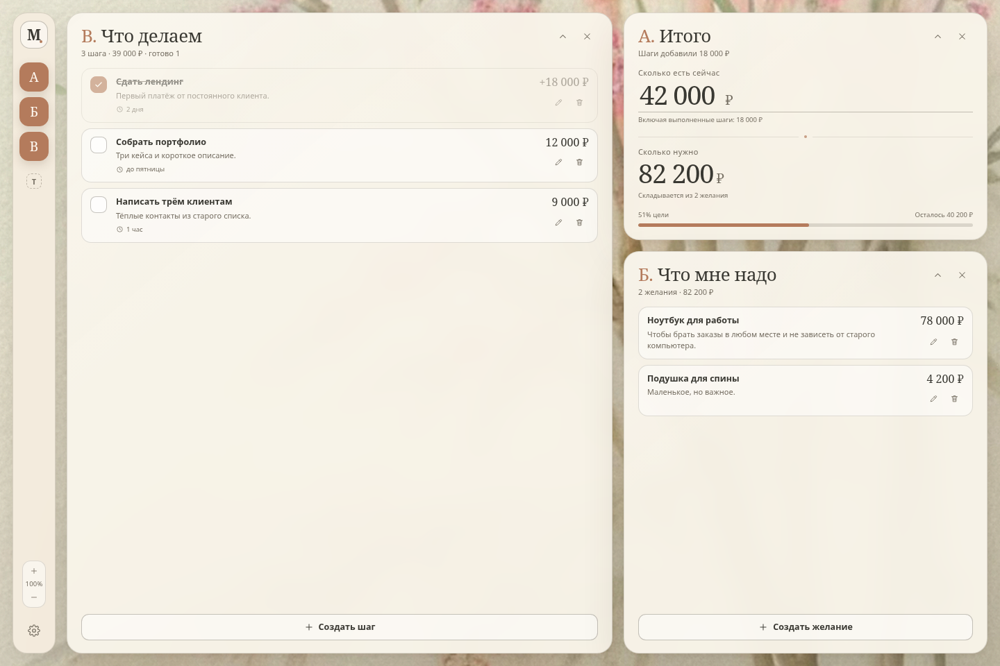
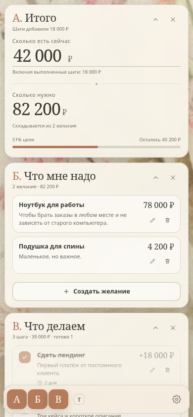
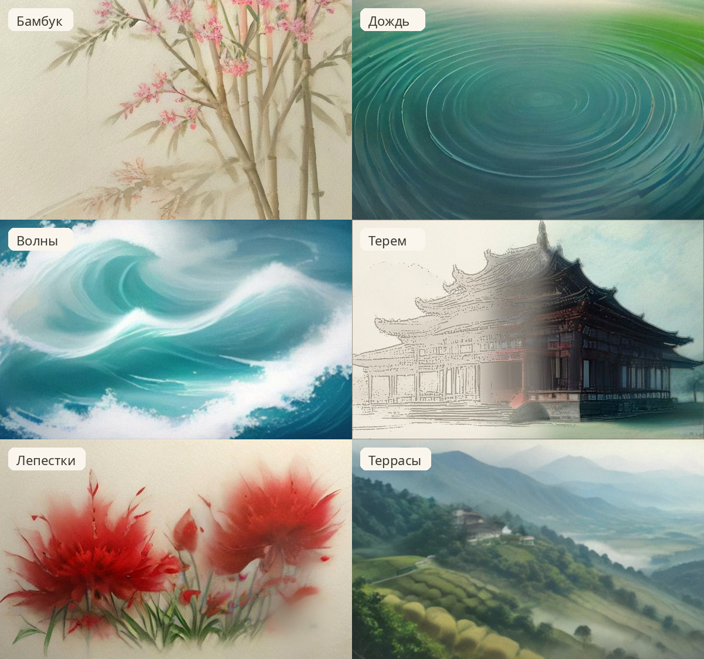
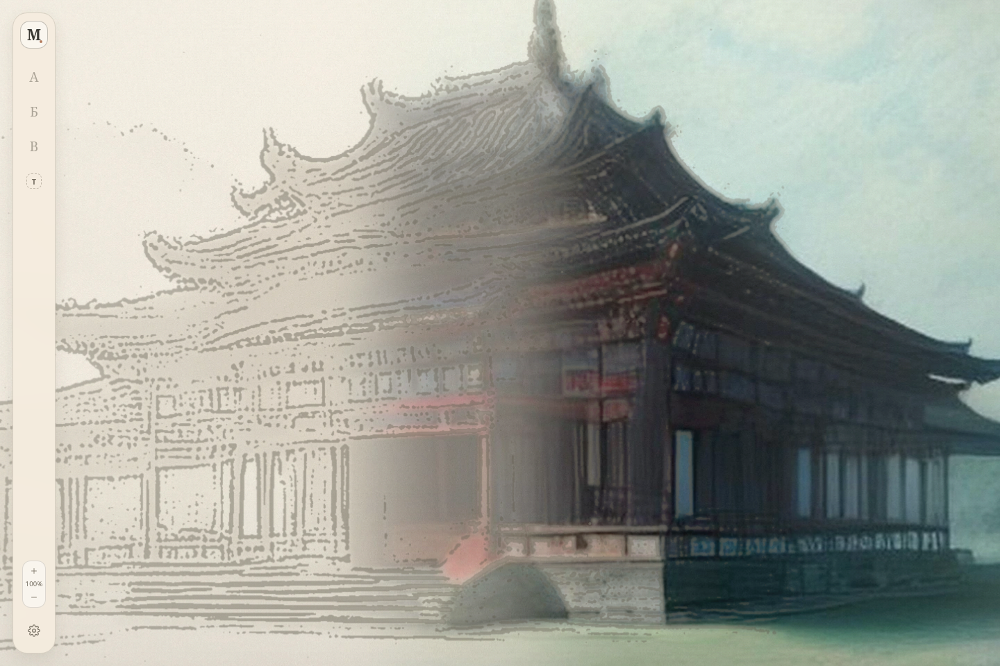

# Must Have

Локальный «умный» калькулятор финансов и заметочник для ближайших планов.
Без облака, аккаунтов, подписок и внешних запросов: приложение целиком лежит в этой папке,
данные — только в `localStorage` браузера.

**Живая версия:** https://jjomoroan.github.io/must-have/

## Быстрый запуск

На рабочем столе уже установлен ярлык **Must Have**. Двойной клик открывает приложение
в отдельном окне Chrome без адресной строки.

Если ярлык потерялся:

```bash
./install-desktop.sh   # переустановить иконку и ярлык
./start.sh             # запустить без ярлыка
```

`start.sh` поднимает локальный статический сервер на `127.0.0.1:41777` и открывает Chrome
в режиме приложения. Сервер нужен только для отдачи файлов; он не отправляет данные наружу.

Резервная копия: **Дополнительно → Архив → Экспорт в JSON**.
Импорт заменяет текущие данные после подтверждения.









## Что внутри

- **А. Итого** — «Сколько есть сейчас» (ручной ввод, максимум 6 цифр) и
  «Сколько нужно» (сумма желаний из блока Б). Выполненные шаги добавляются в «Есть сейчас»,
  снятая отметка вычитает их обратно. Есть прогресс цели.
- **Б. Что мне надо** — желания с названием, описанием и ценой. Новое желание появляется сверху.
  Редактирование, удаление с подтверждением, автоматический пересчёт А2.
- **В. Что делаем** — шаги с названием, описанием, суммой, временем на выполнение и чекбоксом.
  Выполненный шаг становится тусклым, его сумма попадает в А1.
- **Свернуть** и **Закрыть** — разные действия. Свёрнутый блок остаётся строкой с заголовком;
  закрытый исчезает и возвращается кнопкой на левой панели.
- **Масштаб текста** — 50 / 75 / 100 / 125 / 150 %. Ширина карточек не меняется.
- **Визуал** — 7 пастельных тем и 6 оригинальных акварельных сцен: цветущий бамбук,
  дождь на воде, волны, недостроенный терем, алые цветы, чайные террасы.
  Каждая сцена состоит из живописной основы и отдельного слоя движения:
  падающие лепестки, дождь и круги на воде, блики, покачивание, дорисовка карандашом.
  Свой фон загружается из файла, сжимается и подгоняется через `object-fit: cover`.
  Референсы не включены в приложение — сцены созданы по описанию и палитре.
- **Архив** — экспорт/импорт JSON и сброс всех данных.
- **Т · Режим тестировщика** — пароль `0211`. Открывает отдельное окно
  **Must have Test** с отдельным хранилищем: действия тестера не меняют основной план.
  В тестовом окне есть «Сбросить настройки» и «Закрыть окно».

Названия блоков везде с буквой и точкой: `А. Итого`, `Б. Что мне надо`, `В. Что делаем`.

## Телефон

Компьютер и телефон должны быть в одной Wi-Fi сети:

```bash
./serve-lan.sh
```

Скрипт напечатает адрес вида `http://192.168.x.x:8080/`. Откройте его в браузере телефона.
Данные телефона хранятся отдельно от компьютерных — перенос через «Архив → Экспорт/Импорт».
На iPhone/Android страницу можно добавить на главный экран (есть manifest и иконки).

## Структура

```text
must-have/
├── index.html              разметка и SVG-спрайт иконок
├── css/style.css           темы, каркас, адаптив, модальные окна
├── js/app.js               состояние, расчёты, localStorage, настройки
├── js/selftest.js          браузерные сценарии проверки
├── assets/backgrounds/     акварельные основы, motion-слои и JPG-миниатюры
├── assets/backgrounds/_v1/ старые векторные фоны (резерв)
├── tools/                  генераторы акварельных основ и motion-слоёв
├── assets/icon*.png|svg    иконка приложения
├── start.sh                запуск в отдельном окне Chrome
├── serve-lan.sh            режим для телефона
├── install-desktop.sh      ярлык и иконка на рабочем столе
├── manifest.webmanifest    PWA-манифест
└── sw.js                   офлайн-оболочка
```

Ключи хранилища:

- основное окно: `must-have.v1`;
- тестовое окно: `must-have.test.<run>.v1`;
- автотесты: `must-have.selftest.v1`.

## Проверка

Автотесты запускаются только по `?selftest=1` и пишут результат в `#selftest-results`:

```bash
python3 -m http.server 41888 --bind 127.0.0.1 --directory must-have &
google-chrome --headless=new --no-sandbox --disable-gpu \
  --window-size=1440,960 --virtual-time-budget=24000 \
  --dump-dom 'http://127.0.0.1:41888/?selftest=1'
```

Проверено в Chrome 150:

- **28/28** сценариев: создание/редактирование/удаление желаний и шагов, лимиты 6/54/3000,
  время шага, чекбоксы и пересчёт А1, сворачивание/закрытие, темы, свой фон, масштаб,
  PIN-режим, архивный импорт и изоляция тестового хранилища.
- Desktop 1440×960 и телефон 390×844; горизонтального переполнения нет.
- При масштабе 150 % ширина карточки не меняется, текст не выходит за экран.
- Ошибок в консоли нет; запуск через `start.sh` и установка ярлыка проверены.
- Движение проверено в реальном Chrome через CDP: основа дышит/панорамируется,
  слой дождя, лепестков и дорисовки терема анимируется; `prefers-reduced-motion` выключает движение.

Скриншоты: `tests/shots/` (desktop, телефон, настройки, архив, обои, все шесть сцен, терем).

Палитра и настроение вдохновлены присланными референсами, но ни одно изображение
из них не используется в приложении.

## Ограничения и следующие шаги

- Ярлык и установщик сделаны для Linux (текущая система). Для Windows/macOS нужен
  отдельный установщик или Electron-обёртка.
- Между устройствами данные не синхронизируются — это осознанное локальное поведение.
- Время шага — свободный текст, таймера нет (по брифу).
- Загруженный фон сохраняется как JPEG-снимок; анимированный GIF станет статичным.
- Следующий логичный слой: упаковка в Electron/PWA-установщик для Windows и macOS,
  плюс горячие клавиши и печать плана.
